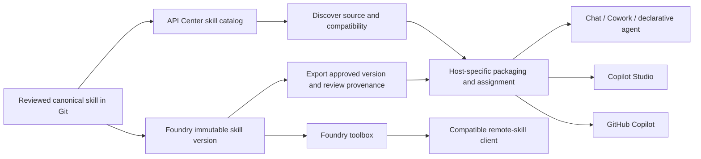

# Additional approach: Foundry + Azure API Center

**Yes for central catalog/distribution; not a universal remote skill runtime.**

API Center supports registering **Skill** assets, source links, lifecycle and
compatibility metadata, optional assessments, and Git synchronization.
Foundry supports immutable skill versions, content export, and preview
toolbox-based remote skill discovery for compatible clients.

API Center is a design-time inventory, not an execution gateway. Registering
a skill does not install it in Copilot or give recipients Foundry access.

## A. Register the skill and distribute reviewed packages

1. Publish the canonical skill source to Git.
2. Create the Foundry version using the [Foundry guide](../foundry/README.md).
3. Export the approved immutable version using `Invoke-FoundrySkill.ps1`.
   Record the version and archive hash. Review the content; do not overwrite
   the canonical source automatically.
4. API Center > Inventory > Assets > Register an asset > **Skill**.
5. Use title Meeting Notes, identifier meeting-notes, the appropriate lifecycle,
   and this source:
   `https://github.com/jameswh3/oge-msft-skills-deployment-examples/tree/main/skills/meeting-notes`.
   For an approved release, use a commit-specific source URL.
6. Describe compatibility as instruction-only Agent Skills; no allowed external
   tools are required. Link the approved release/provenance through supported
   documentation/metadata fields. Do not put credentials in the catalog.
7. Optionally configure Platforms > Integrations > From Git repository for
   this repository's `skills` folder. Verify the pattern matches uppercase
   **SKILL.md**: the documented default displays `**/skill.md`, so do not
   assume case-insensitive matching.
8. Use the API Center portal to discover the skill, inspect the source and
   approved version, then follow the target host's install/assignment guide.

The documented Git integration is not a direct automatic Foundry-to-API-Center
skill synchronization connector. In a Foundry-first workflow, export and review
the approved content into Git before synchronizing the catalog.

For this public sample, Git synchronization does not require a repository PAT.
For private repositories, the documented integration uses a PAT in Key Vault
and API Center managed-identity access to that secret. Never put the PAT into
source or an example JSON file.

Prefer the Free API Center plan for evaluation. Check current feature limits
before enabling assessments, portal features, or Git integrations; do not
silently upgrade to Standard or provision API Management/hosting.

## B. Optional direct remote discovery

Attach the versioned Foundry skill to a toolbox in the **same Foundry project**.
Use a pinned skill version and the versioned toolbox endpoint.

The consumer must support **MCP Resources and the skills discovery extension**:
it lists and reads skills rather than merely listing/calling tools. Microsoft
Agent Framework documents `UseMcpSkills` and toolbox skill providers as examples.

| Consumer | What this repository can claim |
| --- | --- |
| Foundry/Agent Framework compatible skill client | Documented preview remote-skill path; verify authentication, version and actual skill load. |
| Microsoft 365 Chat/declarative agents/Cowork | Native packaging is documented; generic MCP tool connectivity is not proof of remote toolbox skill loading. |
| Copilot Studio | Native upload/sharing is documented; do not assume MCP tool support loads remote skills. |
| GitHub Copilot | Local/repository/plugin skills are documented; verify a specific client's remote discovery extension before claiming this path. Runtime lab testing is unavailable here. |

## C. Calling a hosted capability is a different pattern

It is possible to design an API/MCP tool that invokes a Foundry agent using the
skill, then connect a host to that tool. That **executes the task remotely**;
it does not install or load the skill into the consumer.

That adapter requires hosting, an API contract, per-caller authentication,
authorization, data-boundary decisions, billing, error handling, and runtime
tests. It is not implemented or falsely described as native interoperability
in this instruction-only example. API Center cataloging alone supplies none
of those runtime capabilities.

## Update, rollback and revoke

Promote a reviewed Foundry version; update the catalog's approved reference;
rebuild/assign consumer packages or change pinned remote bindings; verify.
Rollback must restore consumer-bound versions too. Catalog unpublication does
not revoke embedded skill copies; use each host's block/uninstall controls.

Sources: [Register skills](https://learn.microsoft.com/azure/api-center/register-discover-skills),
[Git synchronization](https://learn.microsoft.com/azure/api-center/synchronize-assets-git),
[API Center's design-time boundary](https://learn.microsoft.com/azure/api-center/overview),
[Foundry skills](https://learn.microsoft.com/azure/foundry/agents/how-to/tools/skills),
[Agent Framework toolbox](https://learn.microsoft.com/agent-framework/integrations/by-component/tools/foundry-toolbox).
